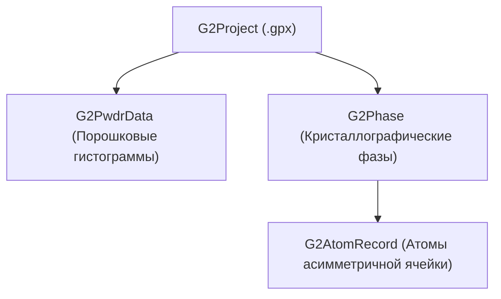

# Справочник по нативному API `GSASIIscriptable`

Данный документ фиксирует официальный API интерфейса скриптования GSAS-II (`GSASIIscriptable`), канонические адреса документации и стандарты вызова ключевых методов без использования самодельных оберток и парсеров.

## 1. Канонические источники документации

- **Sphinx RST Source (SSOT)**: [https://gsas-ii.readthedocs.io/en/latest/_sources/GSASIIscriptable.rst.txt](https://gsas-ii.readthedocs.io/en/latest/_sources/GSASIIscriptable.rst.txt)
- **HTML Rendered Docs**: [https://gsas-ii.readthedocs.io/en/latest/GSASIIscriptable.html](https://gsas-ii.readthedocs.io/en/latest/GSASIIscriptable.html)
- **Учебные материалы и примеры**: [https://advancedphotonsource.github.io/GSAS-II-tutorials/](https://advancedphotonsource.github.io/GSAS-II-tutorials/)

---

## 2. Ключевые классы и их назначение

### 2.1. `G2Project`
Управляет файлом проекта `.gpx`, глобальными параметрами оптимизации и вызовами МНК:
- `gpx.do_refinements(refinements=[{}], histogram='all', phase='all')` — проведение серий шагов уточнения по рецептам. Поддерживает таргетинг `"phases": [name]` и `"histograms": [name]`.
- `gpx.get_LastFitResults()` — возвращает кортеж словарей `(shifts_dict, sigmas_dict)` с точными сдвигами $\Delta$ и погрешностями $\sigma$ из последнего цикла оптимизации.
- `gpx.ComputeWorstFit()` — возвращает кортеж `(keys, derivCalcs, varyList)`, ранжируя варьируемые параметры по величине градиента $|d(\chi^2)/d(\text{var})|$.
- `gpx.set_Controls(control, value, variable=None)` — задание глобальных параметров оптимизатора:
  - `control='cycles', value=N` (при `value=0` — пересчет расчетного профиля и невязок без изменения параметров).
  - `control='parmMin', variable='mask', value=min_val` — нижняя аппаратная граница (Box Constraint).
  - `control='parmMax', variable='mask', value=max_val` — верхняя аппаратная граница (Box Constraint).
- `gpx.copyHistParms(sourcehist, targethistlist='all', modelist=['b', 'i', 'l'])` — перенос параметров фона (`b`), нулей прибора (`i`) и пределов (`l`) между гистограммами серии.

### 2.2. `G2PwdrData`
Представляет данные порошковой дифрактограммы (порошковой гистограммы):
- `hist.residuals` (property) — словарь остатков согласия в оперативной памяти:
  - `wR` — взвешенный профильный R-фактор $R_{wp}$ (%).
  - `wRb` — профильный фактор без фона $wR_{\text{bkg}}$ (%).
  - `R` — невзвешенный профильный фактор $R_p$ (%).
  - `Rb` — фактор $R_p$ без фона (%).
  - `wRmin` — статистический ожидаемый предел $R_{\text{exp}}$ (%).
  - `{phase_id}:{hist_id}:Rf` — структурный фактор Брэгга $R_F$ для фазы.
  - `{phase_id}:{hist_id}:Rf^2` — фактор интенсивностей $R_B = R(F^2)$ для фазы.
- `hist.ComputeMassFracs()` — расчет весовых долей фаз (КФА) по Хиллу–Говарду с учетом истинных кратностей Вайкоффа $Z$ и формульных масс, возвращает `{phase_name: (mass_fraction, esd)}`.
- `hist.Export(fileroot, extension, fmthint)` — нативный экспорт профильных кривых (`fmthint='histogram CSV'`) или списков отражений (`fmthint='refl'`).

### 2.3. `G2Phase`
Представляет кристаллическую фазу в проекте:
- `phase.atoms()` — генератор/список типизированных объектов `G2AtomRecord`.
- `phase.clearDistRestraint()` — очистка ранее заданных межатомных связей-пружин.
- `phase.addDistRestraint(origin, target, bond, factor=1.1, ESD=0.01)` — добавление связей первой координационной сферы.
- `phase.setDistRestraintWeight(factor=100.0)` — задание веса связей в функционале МНК.
- `phase.copyHAPvalues(sourcehist, targethistlist='all')` — копирование параметров фазы для гистограмм серии.

### 2.4. `G2AtomRecord`
Типизированная обертка над записью атома:
- `atom.uiso` — изотропный тепловой параметр $U_{\text{iso}}$ (Å$^2$).
- `atom.coordinates` — кортеж координат $[x, y, z]$.
- `atom.label` — метка атома (например, `'Sm1'`).
- `atom.element` — химический символ (например, `'Sm'`).
- `atom.mult` — кратность позиции Вайкоффа.
- `atom.refinement_flags` — строковые флаги уточнения (`'X'`, `'U'`, `'F'`, `''`).
- `atom.occupancy` — заселенность позиции.

### 2.5. Словарь рецептов Stage-Gate для `gpx.do_refinements()`
Вызовы `{'set': ...}` в GSAS-II кумулятивны, поэтому перед каждой стадией флаги предыдущих стадий очищаются через `reset_stage_flags(gpx, hist)`.

| Стадия | Целевой блок | Словарь рецепта GSAS-II (`build_stage_recipe`) |
|---|---|---|
| **1. Фон и масштаб** | Полином Чебышева и масштабы фаз | `{'Background': {'type': 'chebyschev-1', 'refine': True, 'no. coeffs': N}, 'Scale': True}` |
| **2. Сдвиг / нуль** | Смещение образца или нуль детектора | `{'Sample Parameters': ['DisplaceX']}` *или* `{'Instrument Parameters': ['Zero']}` |
| **3. Решётка** | Параметры ячейки | `{'Cell': True}` |
| **4. Координаты** | Позиции атомов | `{'Atoms': {'all': 'X'}}` |
| **5–6. Тепловые** | Факторы $U_{\text{iso}}$ | `{'Atoms': {'all': 'U'}}` |
| **7. Профиль образца** | Размер ОКР и микронапряжения | `{'Size': {'type': 'isotropic', 'refine': True}, 'Mustrain': {'type': 'isotropic', 'refine': True}}` |
| **8. Текстура** | Марч — Доллас | `{'Pref.Ori.': True}` |
| **9. Заселённость** | Заселённости позиций | `{'Atoms': {'all': 'F'}}` |
| **10. Профиль прибора** | Коэффициенты Кальоти ($U, V, W$) | `{'Instrument Parameters': ['U', 'V', 'W']}` |
| **11. Поглощение / экстинкция** | Поглощение и экстинкция | `{'Sample Parameters': ['Absorption'], 'Extinction': True}` |
| **12. Финальный масштаб** | Только масштабы фаз | `{'Scale': True}` |

---

## 3. Регламентные антипаттерны и их нативные замены

| Запрещенный антипаттерн | Нативный метод | Обоснование |
| :--- | :--- | :--- |
| Самодельный `calculate_hill_howard_qpa` | `hist.ComputeMassFracs()` | Гарантирует учет мультипликативностей Вайкоффа всех позиций ячейки и выдает честные e.s.d. |
| Запрет уточнения координат из-за коллапса | `phase.clearDistRestraint()` + `phase.addDistRestraint()` | Создает физические потенциальные ямы для легких атомов с весом штрафа в МНК. |
| Ручной снимок словарей `prev_state_dict` | `gpx.get_LastFitResults()` | Возвращает истинные сдвиги $\Delta$ и погрешности $\sigma$ последнего шага Левенберга–Марквардта. |
| Мутация по индексам `at.data[10]` | `atom.uiso` через `G2AtomRecord` | Исключает зависимость от внутренних списков GSAS-II при обновлении версий. |
| Парсинг листинга `.lst` регулярками | `hist.residuals` | Исключает дисковые гонки и сбои форматирования; данные доступны сразу в RAM. Листинг — побочный продукт: `discard_gsas_listing()` удаляет его после успешного уточнения. |
| Ручной клампинг параметров в циклах | `gpx.set_Controls('parmMin'/'parmMax')` с контролем через `get_Controls` | Аппаратная защита оптимизатора на уровне вычисления производных Гессиана; регистрация границы подтверждается чтением назад (см. раздел 4). |
| Запись анизотропной микроструктуры **усечённой формой** (4 поля) | Полная запись `Size`/`Mustrain`: `[type, [equatorial, axial, LG], [refine...], axis, [Sij...], [refine...]]` | Усечённая запись делает модель **молча инертной**: `uniaxial` с четырьмя полями не влиял на расчёт (2 % напряжения давали R_wp 7.33 против контрольных 7.36), а та же модель в шести полях сразу дала расхождение до 11.74 %. Слоты обобщённой модели присутствуют даже там, где не используются. |

---

## 4. Эксплуатационные ловушки движка

Перечисленные свойства не описаны в официальном API, но меняют результат уточнения, поэтому учитываются при любом программном обращении к проекту.

1. **`index_ids()` сохраняет проект на диск.** Метод реализован как `self.save()` с последующим `GetUsedHistogramsAndPhases(self.filename)`: таблицы rId-соответствий заполняются ценой записи файла `.gpx`. Следствие: любая проба, устанавливающая границы или читающая идентификаторы, выполняется **на копии** проекта — после такого вызова оригинал уже изменён на диске.

2. **Листинг `.lst` пишется безусловно, и штатно отключить его нельзя.** В `GSASIIstrMain.Refine()` файл `<проект>.lst` (или `<проект>.junk` при запросе всех производных) открывается до чтения `Controls`, поэтому ни одна настройка GSAS-II не отменяет запись. Политика скилла: успешное уточнение листинг удаляет (`discard_gsas_listing`), а падение его сохраняет — листинг пишется в начале `Refine`, тогда как `.gpx` только в `save()`, поэтому при исключении он остаётся единственным следом прогона; флаг `--keep-gsas-listing` и переменная `XRD_KEEP_GSAS_LISTING` оставляют его всегда. Потребителей в конвейере у листинга нет — метрики берутся из объектов проекта.

3. **Ключи словаря границ имеют нестабильный хеш.** `G2VarObj.__hash__` равен `hash(self.varname())`, а `varname()` резолвит rId через `PhaseIdLookup` / `HistIdLookup`, заполняемые только вызовом `index_ids()`. При загрузке проекта с диска таблицы ещё пусты, поэтому ключи попадают в бакеты хеша неразрешённого имени (например `?:?:MD`). После `index_ids()` тот же объект вычисляет хеш от `0:0:MD`, и словарь перестаёт адресоваться по ключу: итерация записи по-прежнему их выдаёт, но `pop`, `in` и `dict[key] = value` либо бросают `KeyError`, либо вставляют дубликат. Функция `prmLookup` обходит словарь итерацией и сравнивает `str(key) == str(name)`, поэтому возвращает **первую** запись, то есть устаревшую. Наблюдаемое следствие: объявленная граница читается назад со старым значением (например заданное `-5.0` читается как `-1000.0`).

   Порядок корректной работы с границами:

   1. вызвать `index_ids()` один раз, чтобы хеши приняли окончательные значения;
   2. пересобрать словарь `parmMinDict` / `parmMaxDict` теми же ключами (пройти по `items()`, очистить, вставить заново) — это восстанавливает соответствие хеша и бакета;
   3. удалить записи целевого параметра и только затем записать новое значение;
   4. прочитать значение назад и сравнить с записанным.

4. **Запись границы не доказывает её действие.** `set_Controls` принимает любое синтаксически корректное имя переменной, поэтому опечатка в маске даёт зарегистрированную, но инертную границу. Единственная проверка — чтение назад через `get_Controls('parmMin'/'parmMax', variable=…)`.

5. **Схема записей параметров гистограммы.** `hist.data['Instrument Parameters'][0][<name>]` — запись из **трёх** полей `[init, value, refine]`: эффективное значение находится в индексе **1**, флаг уточнения — в индексе **2**. Запись булева флага в индекс значения превращает `refine=True` в число `1.0` — так осевая расходимость `SH/L` уходила к верхней границе диапазона. Записи `hist.data['Sample Parameters'][<name>]` состоят из двух полей `[value, refine]`.

6. **Блок ограничений дистанций требует ключ `Use`.** Полная форма секции: `gpx.data['Restraints']['data'][<phase>]['Bond'] = {'wtFactor': …, 'Bonds': […], 'Use': True}`. Функция `GSASIIstrIO.SummRestraints` (и `SetPhaseData`) читает `itemRest['Use']` для каждой присутствующей секции, поэтому блок, собранный без этого ключа, валит ближайшее `refine()` с `KeyError: 'Use'`. Канонические конструкторы секций находятся в `GSASIIphsGUI` (без `Range`) и `GSASIIrestrGUI` (с `Range`).

7. **Подавление verbosity не очищает stdout.** Вывод `G2Print` подчиняется уровню `G2SetPrintLevel`, однако часть сообщений движка печатается голым `print` — например, `GSASIIpath` сообщает об отсутствии `config.ini` строкой `N.B. Configuration file <path> does not exist`. Машиночитаемый вывод защищается удержанием stdout, а не настройкой уровня печати.

8. **Метрики читаются из сохранённых кривых, а не пересчитываются.** Отчёт о состоянии проекта берёт невязки из кривых последнего уточнения, а не из текущих значений параметров, поэтому правка параметра в проекте **не видна** до следующего вызова `refine()`. Следствие: проверка «влияет ли параметр» сравнением метрик до и после правки без пересчёта доказывает отсутствие пересчёта, а не отсутствие влияния; нужен хотя бы один цикл. Ошибка неочевидна тем, что числа выглядят правдоподобно и воспроизводимо.

9. **Коллинеарность инструментальных и образцовых лоренцевых параметров.** Освобождение инструментальных коэффициентов `X, Y, Z` одновременно с размером ОКР (`Size`) и микронапряжениями (`Mustrain`) образца делает систему вырожденной и уводит параметры на аппаратные границы. Инструментальные `X, Y, Z` в стандартном режиме остаются зафиксированными на канонической оптике.

10. **Формулы фазовых факторов `Rf` и `Rf^2` в `hist.residuals` и колонках `RefList`.** В таблице `RefList` (`docs/source/objvarorg.rst`, `PowderRefl_table`) колонка 8 хранит $F_{\text{obs}}^2$, колонка 9 — $F_{\text{calc}}^2$, колонка 11 — `icorr`. В `hist.residuals` под ключами `<phase>:<hist>:Rf` и `:Rf^2` хранятся значения движка: в МНК-ветви (`GSASIIstrMath.py:5149`) `Rf^2` вычисляется по линейной формуле $100 \cdot \sum |\Delta F^2| / \sum F_{\text{obs}}^2$, а в ветви извлечения структурных амплитуд (`GSASIIstrMath.py:3874`) — по среднеквадратичной формуле $100 \cdot \sqrt{\sum (\Delta F^2)^2 / \sum (F_{\text{obs}}^2)^2}$. Поэтому в выводе `status` линейный $R_B(\text{lin})$ и `Rf^2(GSAS)` печатаются раздельно.

11. **`G2ScriptException` наследуется напрямую от `Exception`, а не от `RuntimeError`.** В `GSASIIscriptable` класс `G2ScriptException` имеет MRO `(G2ScriptException, Exception, BaseException, object)` и выбрасывается методами `get_LastFitResults()`, `get_Controls()`, `ComputeWorstFit()` и `get_cell_and_esd()` на проектах, в которых ещё не выполнялось уточнение МНК. Поэтому перехватчикам на границе с движком недостаточно ловить `(RuntimeError, ValueError, KeyError)` — используется фасадная функция `gsas2_adapter.g2_safe_errors()`, динамически включающая `G2ScriptException` при загруженном модуле `GSASIIscriptable`.

12. **Механика `LeBail` и `doPawley`: инициализация `RefList`, регулярность Гессе и неотрицательность интенсивностей.**
    - В `GSASIIstrIO.py` (строка 3131) первичная генерация списка отражений `RefList` защищена условием `if resetRefList and (not hapDict.get(pfx + 'LeBail') or (hapData.get('LeBail', False) and Controls.get('newLeBail', False))):`. Если выставить `hap['LeBail'] = True` до первого расчёта при дефолтном `Controls['newLeBail'] = False`, генерация `RefList` пропускается, и `GSASIIstrMath.GetFobsSq` (строка 3740) падает с `KeyError: 'RefList'`. Кроме того, `GetFobsSq` обновляет только столбец 8 (`F_obs^2`), тогда как `errRefine` строит профиль `Y_calc` из столбца 9 (`F_calc^2`) либо из таблицы Поули `pawleyLookup`.
    - Поэтому для бесструктурного уточнения фаз (включая фазы из карточек PDF-2 без атомных координат, `add-phase --from-card` или `--pawley`) используется двухшаговая инициализация (`xrd_project.enable_pawley_for_phase`):
      1. Выполняется 1 цикл с `doPawley = False` для заполнения `hist.data['Reflection Lists'][phase]['RefList']` (необходимого также для отрисовки штрихов Брэгга в `xrd_plot.py`).
      2. Через `GSASIIlattice.cell2A`, `GSASIIlattice.GenHLaue` и `GSASIIspc.GenHKLf` формируется таблица `phase.data['Pawley ref']` (`[h, k, l, mul, d, refine, I, esd]`), включается `phase.data['General']['doPawley'] = True`, `Pawley neg wt = 10.0`, а масштаб фазы фиксируется на `hap['Scale'] = [1.0, False]` для устранения коллинеарности.
      3. Рефлексы `GenHLaue`, лежащие вне диапазона измерения гистограммы $[2\theta_{\min} + 0.05^\circ,\ 2\theta_{\max} - 0.05^\circ]$, обязательно помечаются неактивными (`refine = False, I = 0.0`), иначе нулевые производные $\partial Y / \partial I_{hkl} \equiv 0$ порождают сингулярные столбцы в матрице нормальных уравнений (`dropping singularities`).
      4. В `GSASIIstrMath.py` (строка 4484) производная по интенсивности Поули вычисляется через деление `dMdpw = dervDict['int'] / refl[9+im]`. Поэтому на промежуточных стадиях `step` отрицательные интенсивности проецируются в положительную величину `5.0` с сохранением `refine = True`, а при обнулении `I = 0.0` на финальной стадии обязательно снимается флаг `refine = False` (`xrd_project.clamp_pawley_reflections`), иначе возникает деление `0.0 / 0.0 = NaN` и сбой `ouch #2 bad SVD inversion`.
      5. В чисто Pawley-проектах (без атомных вкладов) вызов 0-цикловой оценки (`cycles = 0`, `do_refinements([{}])`) сбрасывает рассчитанный профиль `Y_calc` до чистого фона ($R_{wp} \approx 300\%$), поскольку переменные `PWLref` суммируются в профиль только при активном цикле МНК.
      6. В функции `GSASIIstrMath.calcMassFracs` (строка 5247) в апстрим-коде GSAS-II имеется опечатка переменной цикла (`if Phases[phase]['General']['doPawley']: continue` вместо `Phases[phasej]`), которая автоматически исправляется идемпотентной проверкой в `stage_gate_rietveld.ensure_gsas2_environment()`.

---

## 5. Владение состоянием: проект и рецепт

Состояние уточнения описывают два файла, и у каждого своя область истины.

**`.gpx` владеет значениями.** В нём лежат текущие числа, ковариационная матрица, контролы и таблицы отражений; любая команда пересчитывает производные из него. Никакой другой файл не может быть источником истины о значениях параметров.

**`_params.json` владеет флагами уточнения.** Это декларативный рецепт (`params dump` → правка → `params refine`): какие параметры уточняются, какие закреплены, с каких значений начинается шаг. Сдвиги последнего цикла в него не переносятся — это рецепт, а не снимок проекта.

**Рецепт устаревает от любой `step`.** Маршрут `step` задаёт флаги кодом стадий и не читает `_params.json`; после него рецепт описывает прошлое состояние. Перед `params refine` нужен свежий `params dump`, иначе декларативный маршрут уточняет то, чего в проекте уже нет. Устаревший рецепт опаснее отсутствующего: он выглядит авторитетно.
