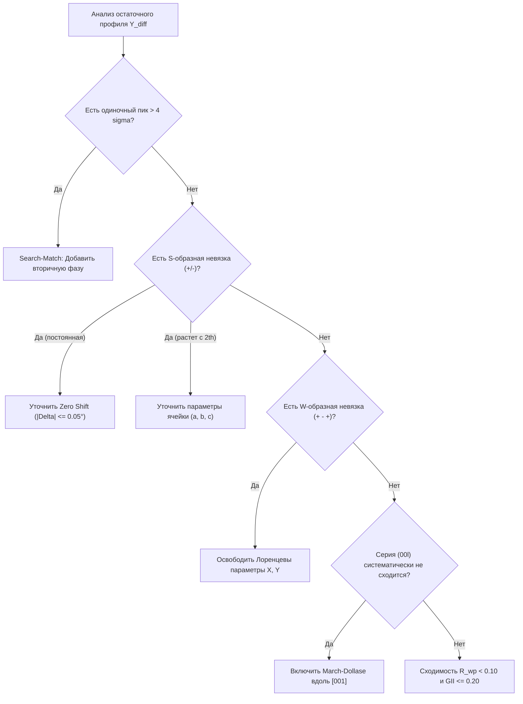

# Clinical Rietveld Troubleshooting Guide (Difference Curve Diagnostics)

This reference guide provides an operational diagnostic atlas for autonomous agents and crystallographers analyzing powder X-ray diffraction patterns. When Rietveld refinement shows residual discrepancy in the difference curve ($Y_{\text{diff}} = Y_{\text{obs}} - Y_{\text{calc}}$), use this symptom-cause-action playbook.

---

## 1. Fast Diagnostic Matrix

| Residual Profile Symptom ($Y_{\text{diff}}$) | Physical / Crystallographic Root Cause | Recommended Action in Refinement Protocol |
| :--- | :--- | :--- |
| **Sharp isolated positive peak** ($\Delta I > 4\sigma_{\text{bg}}$) | Unindexed impurity phase or unmodeled precursor | Run `search_match.py` on residual profile $Y_{\text{diff}}$. Check synthesis precursors and plausible secondary phases. |
| **Derivative-like S-curve (+/- or -/+)** across every peak | Peak position mismatch: Detector Zero-Shift or Unit Cell parameters ($a, b, c$) | If angular error $\Delta 2\theta$ is constant: refine Zero-shift (bound $|\Delta 2\theta| \le 0.05^\circ$). If $\Delta 2\theta$ increases with $\tan\theta$: refine unit cell dimensions. |
| **W-shaped ripple (+ - +) centered at peak** | Profile shape error: wrong Gaussian/Lorentzian ratio (pseudo-Voigt $\eta$) | Adjust pseudo-Voigt profile broadening. Release Lorentzian $X$ (crystallite size) and $Y$ (microstrain). Never allow profile parameters below instrumental lower bounds. |
| **Asymmetric tail only at low angles** ($2\theta < 25^\circ$) | Axial beam divergence / Soller slit geometry | Enable Finger-Cox-Jephtcoat (FCJ) asymmetry parameter (limit refinement to low-angle range). |
| **Systematic overestimation of $(00l)$ peaks** ($Y_{\text{obs}} > Y_{\text{calc}}$) | Preferred orientation (texture) from platy/lamellar crystallite morphology | Activate March-Dollase preferred orientation along cleavage plane (typically $[001]$ for layered chalcogenides/oxides). Restrict $r \in [0.7, 1.3]$. |
| **High-angle intensity attenuation** ($Y_{\text{calc}} \gg Y_{\text{obs}}$ at $2\theta > 60^\circ$) | Underestimated atomic thermal displacement ($B_{\text{iso}}$) or unmodeled sample absorption | Check $B_{\text{iso}}$ hierarchy: ensure $B_{\text{cation}} \le B_{\text{anion}}$. For heavy scatterers (lanthanides, actinides) on Cu $K\alpha$, enable cylindrical absorption correction. |
| **Broad undulating background hump** ($2\theta \approx 20–35^\circ$) | Amorphous phase fraction, glass sample substrate, or unreacted polymer gel | Fit background using Chebyshev polynomials (8–12 terms) or add a broad pseudo-Voigt diffuse scattering background component. |
| **Every reflection uniformly too sharp, $R_{wp}$ implausibly low** | Runaway axial divergence: $SH/L$ refined without an upper bound absorbed genuine sample broadening instead of describing the instrument | Bound $SH/L$ to the instrumentally plausible range ($[0, 0.05]$, canonical value $0.002$) and re-refine. Check the flag/value slot of the instrument record before blaming the bound itself. |

An agreement factor is only as meaningful as the profile it came from. A low $R_{wp}$ obtained with a physically unreachable peak shape — every reflection equally narrowed by an over-large $SH/L$, or profile coefficients driven past the instrumental limits — is a fitting artefact, not a result. Bound the profile parameters first, re-refine, and report the metrics of the bounded model.

---

## 2. Deep Dive: Peak Position Anomalies

### 2.1. Zero-Shift vs. Unit Cell Drift
Diffractometer geometry errors produce characteristic angle-dependent shifts:
1. **Specimen Displacement Error**:
   $$\Delta 2\theta = -\frac{2s}{R} \cos\theta$$
   where $s$ is sample displacement off the focusing circle (in mm) and $R$ is goniometer radius. Shifts diminish at high $2\theta$.
2. **Lattice Parameter Mismatch**:
   Bragg's Law differentiation yields:
   $$\frac{\Delta 2\theta}{\tan\theta} = -2 \frac{\Delta d}{d}$$
   The shift $\Delta 2\theta$ grows dramatically with increasing $2\theta$ proportional to $\tan\theta$.
   * Diagnostic Rule: If the derivative S-shaped residual worsens at higher angles, the problem is unit cell metrics ($a, b, c$), not zero shift.

---

## 3. Deep Dive: Profile Broadening and Shape Deficiencies

### 3.1. Gaussian vs. Lorentzian Physics
Powder peak shapes follow the Thompson-Cox-Hastings (TCH) pseudo-Voigt formulation (see `references/stage-gate-protocol.md` §3.3 for exact Caglioti, Scherrer, and Stokes-Wilson equations):
* **Gaussian Broadening ($U, V, W$)**: dominated by instrumental optics and slit geometry; bounded below by canonical laboratory optics.
* **Lorentzian Broadening ($X, Y$)**: $X$ (\propto $1/\cos\theta$) captures finite crystallite size; $Y$ (\propto $\tan\theta$) captures lattice microstrain.
* **Diagnostic Rule**: If sharp peak centers are well fitted but peak tails are underestimated, release Lorentzian size $X$; if broadening grows rapidly at high angles, release microstrain $Y$.

---

## 4. Deep Dive: Preferred Orientation (Texture)

In powder packing, anisotropic morphology (platelets, needles) leads to non-random crystallite orientation.
* **March-Dollase Equation**:
  $$P(\alpha) = \left(r^2 \cos^2\alpha + r^{-1} \sin^2\alpha\right)^{-3/2}$$
  - $r = 1.0$: Perfectly random orientation (ideal powder).
  - $r < 1.0$: Platelet habit (compression along preferred axis, e.g., flakes lying flat).
  - $r > 1.0$: Needle/acicular habit (fibers aligning along capillary axis).
* Guardrail: An $r$ value outside $[0.6, 1.4]$ indicates either an over-parameterized refinement absorbing incorrect atomic coordinates, or a poorly prepared sample requiring experimental re-grinding.

---

## 5. Phase-Specific Diagnostic Matrix: $R_B$ vs. $R_{wp}$

In multiphase mixtures, global profile factors ($R_{wp}$) can mask severe structural flaws in secondary phases:

| Диагностический признак | Кристаллографическая причина | Действие агента / исследователя |
| :--- | :--- | :--- |
| **$R_{wp}$ высок ($14\dots 20\%$), но $R_B < 6\%$** для всех фаз | Атомная кристаллическая модель **идеальна**. Невязка вызвана аппаратными факторами профиля. | Запретить варьирование координат атомов и заселенностей! Уточнять только: инструментальный фон (Чебышев), нуль детектора, форму пиков (Caglioti $U,V,W$, асимметрию FCJ). |
| **$R_{wp}$ низок ($7\dots 10\%$), но $R_B > 20\%$** для минорной фазы | Профиль формально подогнан за счет фона и раздутой полуширины, но **структура фазы грубо ошибочна**. | Фаза выбрана неверно! Проверить: правильность пространственной группы, позиции Вайкоффа, отсутствие тяжелых элементов-заместителей, провести повторный `search_match.py`. |
| **$R_{wp} / R_p > 1.45$** при нормальном $R_B$ | Ошибки сосредоточены в областях с низкой интенсивностью. | Проверить наклон хвостов рефлексов (добавить лоренцеву долю $\eta$ в pseudo-Voigt) и вогнутость фона. |

---

## 6. Durbin-Watson Residual Autocorrelation ($d$-statistic)

Статистика Дарбина — Уотсона $d$ оценивает сериальную корреляцию соседних отсчётов остатка (формула и веса — в `references/stage-gate-protocol.md` §4):
* **$d \in [1.5; 2.5]$ (Допустимый коридор сходимости, идеал белого шума $\approx 2.0$):** систематические невязки моделирования отсутствуют.
* **$d < 1.0$ (Патология положительной автокорреляции):** соседние остатки одного знака формируют длинные волны вдоль $2\theta$ — признак неучтённой асимметрии линий, неверной формы хвостов пиков или пропущенных слабых рефлексов.
* **$d > 3.0$ (Отрицательная автокорреляция):** высокочастотные знакопеременные скачки («зубья пилы») при численном переопределении или артефактах сглаживания.

---

## 7. Standard Uncertainties (e.s.d.) Diagnostics

Оценка диагональных элементов ковариационной матрицы $\text{Cov} = (J^T W J)^{-1} \cdot \text{GoF}^2$:
1. **Аномально раздутые погрешности ($\sigma(p)/p > 10^{-2}$ или $\sigma(B) > B$):**
   Свидетельствуют о сильной кросс-корреляции параметров ($|\rho| > 0.85$). Типичные пары взаимного поглощения:
   - Масштабный фактор фазы $S$ и общий тепловой фактор $B_{\text{overall}}$;
   - Параметры Кальоти $U$ и $W$;
   - Координаты $z$ и заселенность позиции $g$ на зеркальных плоскостях.
   *Действие:* Наложить линейную связь или зафиксировать один из коррелирующих параметров на табличном значении.
2. **Нулевые погрешности ($\sigma = 0$):**
   Параметр был жестко заморожен в скрипте или достиг границы ограничений (Box Constraint).

---

## 8. Decision Flowchart for Autonomous Supervisor

---

## 9. Peaks of Non-Structural Origin

A peak matching no phase in the candidate pool is not automatically a missing phase. Before extending the pool, exclude the instrumental and geometric sources listed here: they are reproducible and common, and attributing one of them to a crystalline phase yields a false quantitative result.

| Source | Signature | Check / action |
| :--- | :--- | :--- |
| Residual $K\beta$ ($\lambda_{K\beta} \approx 1.392$ Å for Cu) | Weak companion of every strong reflection, at $\sin\theta_{K\beta} = (\lambda_{K\beta}/\lambda_{K\alpha})\sin\theta_{K\alpha}$; scales with the $K\beta/K\alpha$ ratio of the target and the filter used | Check the filter condition; if present, model the $K\beta$ contribution. Never fit a phase to it. |
| Tube-material lines (W $L\alpha$, Cu, Mo, Fe impurity lines) | Sharp lines not indexable by any plausible phase of the sample, at angles independent of the sample | Compare with a blank scan; verify the tube target rather than the sample. |
| Sample-holder / substrate reflections | Position independent of sample rotation or repacking, frequently of constant intensity | Scan the empty holder; subtract it or mask that angular window explicitly. |
| Escape peaks (energy-dispersive set-ups) | Weak peak at $E_{\text{line}} - 1.74$ keV (Si $K\alpha$ of the detector) | Check the detector calibration; keep it out of the crystallographic pool. |
| Monochromator higher-order contamination ($\lambda/2$) | Weak extra peaks at angles where $\sin\theta$ is halved relative to a strong reflection | Check the monochromator setting. |
| Unfiltered white radiation / fluorescence | Broad background rise rather than a peak | Adjust filter and background model; it is not a phase. |

Rules of use:

1. A peak enters this category only with a **named mechanism** and a check confirming that the mechanism explains its position and intensity. «Probably instrumental» is not a category.
2. Such peaks are excluded from the crystallographic pool but stay listed in the report: silent suppression hides a real sample feature whenever the attribution is wrong.
3. When residual diagnostics report unindexed peaks, consult this table before expanding the elemental pool or generating analogs.
